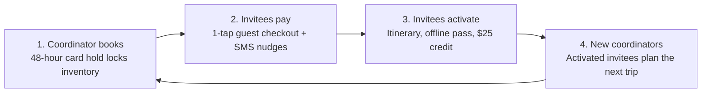

# GTM Strategy · Roamly Groups

## 1. Discover Framework

### Align on the Goal
- **Core business problem:** Roamly is bleeding high-intent, high-order-value demand at the point of conversion. Users are actively hacking the platform across disconnected accounts to book group experiences, but severe booking and payment friction leads to high drop-offs, lost booking fees, and customer support strain.
- **What success looks like:** Success means establishing a zero-friction collaborative booking loop that converts group coordinators into brand advocates. Beyond lifting group gross booking value (GBV) and checkout completion rates, it turns every group trip into an organic acquisition engine—onboarding multiple verified new travelers per booking without increasing paid acquisition spend.

### Do the Research
- **Signals of a real opportunity:** Signal 3 (Behavioral Workarounds): Telemetry and support logs show users manually syncing availability across separate accounts and managing split payments off-platform. They are actively forcing a single-player product into a multiplayer use case, enduring friction just to transact.
- **Top 5 possible segments:** 1. Milestone Celebration Planners (bachelor/bachelorette, milestone birthdays)
2. Multi-Generational Family Organizers (parents coordinating family trips)
3. Remote / Distributed Team Offsite Coordinators (startups & small teams booking local team-building activities)
4. Friend Group 'Trip Captains' (friend circles traveling internationally together)
5. Affinity & Special Interest Communities (alumni, running clubs, amateur foodies traveling in small pods)
- **How to size the opportunity:** 1. Internal 1P Data: Sizing lost GMV from multi-ticket drop-offs and support ticket volume mentioning group booking/split pay.
2. Market Reports: Sizing global travel booking spend allocated to small-group/experiential leisure travel (Phocuswright, Skift).
3. Competitor & Alternative Analysis: Quantifying Airbnb Experiences vs. dedicated group booking solutions (e.g., Tab, Splitwise integration rates) and social volume on Reddit/TikTok regarding group trip planning pain points.

### Build a Working Team
- **Cross-functional stakeholders:** 1. Trust & Safety / Risk: Split payment handling, fraud prevention, and dispute resolution if one group member charges back.
2. Customer Experience / Support: Translating existing customer ticket patterns into edge cases (cancellations, partial refunds).
3. Finance & Payments: Merchant fees, multi-currency escrow, and payout timelines to hosts.
4. Product Marketing (PMM): Positioning, coordinator enablement assets, and viral invite loop optimization.
5. Host Operations / Community: Host training and ensuring hosts can handle varied group dynamics seamlessly.

### Form Your Hypothesis
- **Most valuable segment to target first, and why:** The 'Stressed Trip Captain' / Milestone Celebration Planner (bachelor/bachelorette and friend group organizers). They have the highest urgency, immediate willingness to adopt a split-payment tool, and their invitees represent high-retention prospective users who get introduced to Roamly through an organic viral loop.
- **Core value proposition:** Zero-chase group booking: Lock in curated local experiences and split the bill at checkout so you never have to front thousands of dollars or chase friends on Venmo again.

## 2. GTM motion

- **Chosen motion:** PLG
- **Why:** Primary: Product-Led Growth (PLG). Group leisure travel operates with short time-to-value (minutes), individual consumer purchasing authority, and low-to-mid transactional ACV that cannot support human sales touchpoints. Growth must scale natively via product virality—the collaborative booking and split-payment workflow is inherently multiplayer, turning every group coordinator's booking into an organic invite loop for peer travelers.

## 3. Primary goal

Expand

## 4. The assumption I'm pushing back on

I am pushing back on Assumption 2: that invitee friction and forced signups will stall checkout and break the PLG loop. We are not forcing full account registration or identity verification on invitees at checkout; they pay via frictionless 1-click guest checkout (Apple Pay / Google Pay). Furthermore, payment risk is managed via an automated 48-hour card hold placed by the Coordinator with automatic SMS nudges, guaranteeing inventory hold without leaving Roamly or the Coordinator with stranded seats. Invitee conversion to Roamly users is an intentional secondary onboarding loop post-payment (unlocking shared itineraries, offline passes, and a $25 credit toward their next trip), not a checkout gate.

## 5. V1 GTM strategy one-pager
# Roamly Groups: GTM V1

**Status:** V1 Draft (Internal) | **Owner:** [OWNER] | **Updated:** Oct 30, 2026
**Reviewers:** Trust & Safety, Finance & Payments, Customer Experience, PMM, Host Operations

---

## Summary

Group demand already lives on Roamly. It is hacked across accounts and off-platform payments, so high-value bookings drop at checkout. Roamly Groups turns that workaround into a product and every booking into an invite loop.

## Problem

Users sync availability across separate accounts and split payments off-platform. The result is checkout drop-off, lost booking fees, and customer support strain.

## Target

- **Beachhead:** Stressed Trip Captains (bachelor/bachelorette and friend-group organizers)
- **Parallel test:** Team offsite coordinators, as the repeat-use segment
- **Validation:** Confirm with workaround telemetry by segment before locking the choice

## Value Proposition

> Book the experience, split the bill at checkout, never chase friends for money. Guests pay in one tap, no account needed.

## Motion: Product-Led Growth (Invitee Loop as the Engine)

| Step | What happens |
|------|--------------|
| 1. Coordinator books | Places a 48-hour card hold to lock inventory |
| 2. Invitees pay | 1-click guest checkout via Apple Pay or Google Pay, with automatic SMS nudges |
| 3. Invitees activate | Post-payment onboarding: shared itinerary, offline pass, $25 credit toward next trip |
| 4. New coordinators | Activated invitees become the next group's coordinator |

## Channels (Priority Order)

1. **Convert existing demand.** Target multi-ticket carts, large-group searches, and known workaround users with a "Make this a group booking" prompt in cart, email, and push.
2. **Invitee loop.** The share link and SMS nudges are the main acquisition surface. Optimize guest checkout, the activation screen, and credit size.
3. **Intent capture.** SEO for "[city] bachelorette activities" and group-trip queries, plus wedding and bachelorette creator partnerships.
4. **Minimal paid.** Retarget group-intent searchers only. Organic supplements acquisition; it does not replace it.

## North Star Metric

**Activated new users per completed group booking**

Guest payers who finish post-payment onboarding within 7 days, divided by completed group bookings. This tests the viral thesis directly. Numeric targets will be set once cart and support baselines are in.

## Guardrails

| Metric | What it tells us |
|--------|------------------|
| Group checkout completion | All seats paid before the hold expires |
| Coordinator fallback rate | Share of groups where the coordinator absorbs unpaid seats |
| 90-day rebooking rate | Whether activated invitees book again, which proves the $25 credit pays back |
| Group GBV and support tickets | Gross booking value and support load per group booking |

## Open Questions for V2

- [ ] What happens to unpaid seats at hold expiry, and who carries the risk?
- [ ] Which segment shows the highest workaround volume in telemetry?
- [ ] What invitee activation rate justifies the $25 credit?
